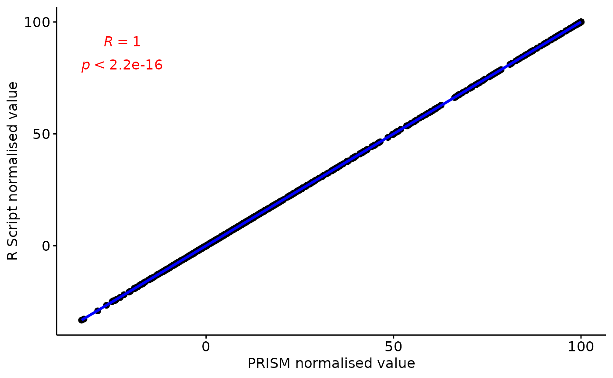

# normalisation_script_validation

``` r

plot<-ggpubr::ggscatter(df, x = "PRISM normalise", y = "Script normalise",
          add = "reg.line", add.params = list(color="blue", fill="lightgrey"), conf.int = TRUE, # Add confidence interval
          cor.coef = FALSE, cor.method = "pearson", # Add correlation coefficient. see ?stat_cor
          xlab = "PRISM normalised value", ylab = "R Script normalised value")+ ggpubr::stat_cor(cor.coef.name = "R",color="red", method = "pearson", label.sep = "\n")

#ggplot2::ggsave("../man/figures/validation_correlation_plot.png",plot)
print(plot)
```


